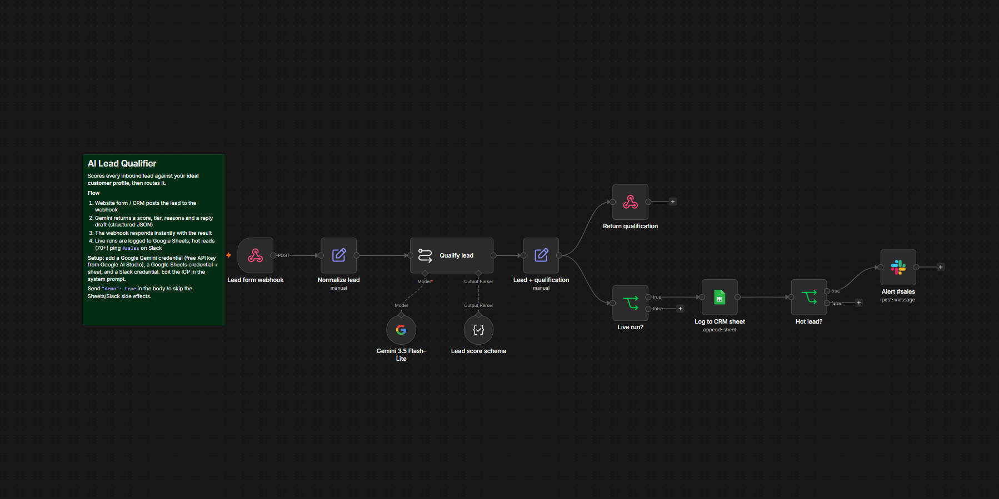

# Flowbench — n8n Automation Pack

Seven production-ready **n8n** workflows with **Google Gemini** inside, a gallery site where each one can be **run live**, and a one-script **$0/month** deployment on Oracle Cloud (Terraform for AWS included).

**Live gallery:** _add your Vercel URL here_ · **n8n:** 2.40.7 · **AI:** Gemini 3.5 Flash-Lite / Gemini 3.6 Flash (free tier) · **Hosting:** Oracle Cloud Always Free



## The workflows

| # | Workflow | What it does | Live demo |
|---|----------|--------------|-----------|
| 01 | **AI Lead Qualifier** | Scores inbound leads 0–100 against your ICP, logs to a Sheets CRM, alerts `#sales` for hot leads, drafts a reply | ✅ |
| 02 | **Invoice & Receipt Extractor** | Gmail PDF → text → structured JSON (GST/HST/PST/QST, line items, category); totals re-checked in code; posts problems to `#finance` | ✅ |
| 03 | **Support Inbox Triage** | Classifies each email, scores urgency & sentiment, escalates urgent/angry tickets to Slack, leaves a draft reply in the Gmail thread | ✅ |
| 04 | **Content Repurposing Engine** | URL or text → LinkedIn post, X thread, newsletter blurb, Instagram caption, hooks; queued in a content calendar | ✅ |
| 05 | **Appointment Reminders & No-show Recovery** | 24h/2h SMS or email reminders from any booking API every 15 min; AI rebooking message after a no-show | ✅ |
| 06 | **Weekly KPI Report** | Postgres → week-over-week KPIs computed in code → Gemini writes the summary → HTML email + Slack digest | ✅ |
| 07 | **Global Error Alerts** | Error workflow for everything else: Slack + email with a link to the failed execution | — |

Every workflow with a webhook accepts `"demo": true`, which returns the AI result but skips all side effects (no emails, Slack messages or sheet rows). The gallery site always sends it.

## Repository layout

```
tools/
  lib.mjs                 builder API: nodes, connections, AI steps, sticky notes, provider table
  workflows/*.mjs         the 7 workflows, authored as code
  build.mjs               → workflows/*.json (+ catalog.json); --credentials / --protect for real instances
  validate.mjs            checks every node type, version, parameter and option against n8n's own schemas
  test-code-nodes.mjs     unit tests for the JavaScript inside Code nodes
  dev-credentials.mjs     placeholder credentials for a LOCAL test instance
  e2e/mock-llm.mjs        stand-in for the Gemini (and Anthropic) APIs
  e2e/run.mjs             imports, publishes and calls every webhook in a real n8n container
workflows/                generated, importable JSON — what clients download
infra/
  docker-compose.yml      n8n + Postgres 16 + Caddy (automatic HTTPS)
  Caddyfile               TLS, security headers, editor IP allowlist (webhooks stay public)
  oracle/                 setup.sh + README: free Oracle Cloud Ampere VM in one script
  scripts/                backup.sh (local rotation, optional S3), restore.sh, deploy-workflows.sh
  terraform/              AWS alternative: EC2 t4g.small, Elastic IP, SG, IAM, SSM secrets, S3 backups
site/                     Next.js 16 gallery with live playgrounds (Vercel)
```

## AI provider

Gemini is the default: the [Google AI Studio](https://aistudio.google.com) free tier covers demo traffic and the n8n node only needs an API key. Extraction and classification use **Gemini 3.5 Flash-Lite**; writing tasks use **Gemini 3.6 Flash**. Both model IDs live in one table in `tools/lib.mjs`.

The templates can be regenerated on Claude instead: `AI_PROVIDER=anthropic npm run build` (add an `lmChatAnthropic` entry to your credentials file).

## Quality gates (CI)

| Job | What it proves |
|-----|----------------|
| **workflows** | Generated JSON is committed and current; every node/parameter is valid for n8n 2.40.7; Code-node logic passes unit tests |
| **e2e** | Real n8n in Docker + mock Gemini: all six webhook workflows are published, called and their responses asserted |
| **infra** | `terraform fmt` + `validate`, Compose config, Caddyfile, ShellCheck (incl. the Oracle setup script) |
| **site** | Lint + production build |

## Run it locally

```bash
npm install
npm run check            # build + validate (needs N8N_NODES_JSON, see CI) + Code-node tests

# Import into any n8n: Workflows → Import from file → workflows/01-ai-lead-qualifier.json
```

End-to-end test against a local n8n (Docker):

```bash
docker run -d --name n8n-dev -p 5690:5678 -e N8N_SECURE_COOKIE=false n8nio/n8n:2.40.7
# create infra/.env.local-dev with N8N_DEV_URL / N8N_DEV_EMAIL / N8N_DEV_PASSWORD,
# set up the owner at http://localhost:5690, then:
node --env-file=infra/.env.local-dev tools/dev-credentials.mjs
npm run mock:llm &         # separate terminal
npm run e2e                # mock Gemini
npm run e2e:live           # real Gemini key set in the n8n UI
npm run samples:record     # …and save the responses as the site's recorded samples
```

Gallery site:

```bash
cd site
pnpm install
pnpm dev                 # http://localhost:3000 — serves recorded samples until N8N_WEBHOOK_BASE is set
```

## Deploy

**1 · n8n on Oracle Cloud — free.** Create an Always Free Ampere A1 VM (Ubuntu 24.04), open TCP 80/443 in the VCN security list, SSH in and run:

```bash
git clone https://github.com/owaiskhalid-si/n8n-automation-pack
sudo bash n8n-automation-pack/infra/oracle/setup.sh --domain n8n.example.com --email you@example.com
```

Without `--domain` it uses `<public-ip>.sslip.io`, which works with Let's Encrypt out of the box. The script opens the ports Oracle's images block by default, installs Docker, generates the secrets, starts n8n + Postgres + Caddy and schedules nightly backups. Step-by-step console instructions: [`infra/oracle/README.md`](infra/oracle/README.md).

_AWS instead?_ `cd infra/terraform && terraform apply` provisions a Graviton instance in ca-central-1 that bootstraps itself from this repository, with secrets in SSM Parameter Store and backups in S3 (≈ US$15/month).

**2 · Credentials and workflows.** In the n8n editor create your credentials (Google Gemini, Google Sheets, Slack, Gmail, Twilio, SMTP, Postgres) and a **Header Auth** credential named _Demo gateway key_ (`X-Demo-Key: <random value>`). Copy `infra/credentials.example.json` to `infra/credentials.json`, fill in the credential IDs, and run:

```bash
PROTECT=1 infra/scripts/deploy-workflows.sh
```

**3 · Gallery on Vercel** — import the repo, set **Root Directory** to `site`, and add `N8N_WEBHOOK_BASE=https://your-n8n-domain` and `N8N_DEMO_KEY=<the header value>`. Without them the site serves recorded runs, clearly labelled.

## Cost

**$0/month**: Oracle Cloud Always Free (Ampere A1, 4 OCPU / 24 GB) + Vercel Hobby + the Gemini free tier. The site rate-limits each visitor, and demo runs skip every paid side effect. The AWS alternative is about US$15/month.

## License

MIT
